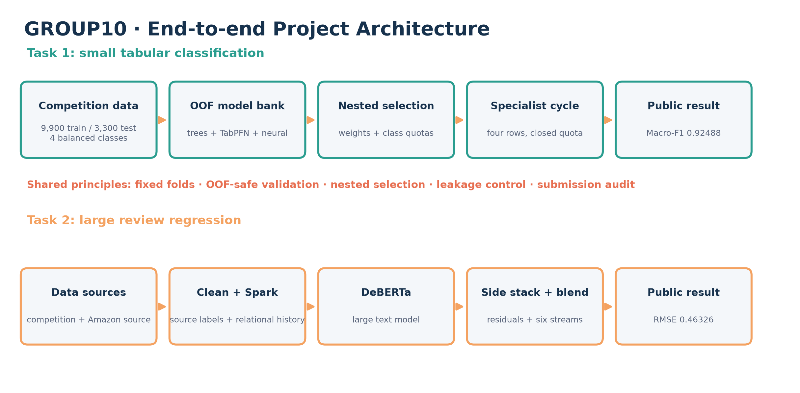

# GROUP10 · COMP5434 Kaggle 项目作品集

> 两个端到端 Kaggle 任务：表格数据分类与评论评分回归。
>
> 重点展示防泄漏验证、嵌套集成、标签修复、特征工程与可复现提交。

## 快速入口

- [轻量项目 ZIP](code/GROUP10_DELIVERY.zip)：Task 1 / Task 2 代码、运行说明、指标与最终提交
- [网页作品集](index.html)：整体项目介绍、架构图和下载入口
- [全项目技术总结](documents/GROUP10全项目技术总结.docx)
- [最终指标与提交文件](evidence/)
- [作品集文件清单与 SHA-256](PORTFOLIO_MANIFEST.json)

> GitHub 文件预览不会运行 `index.html`。若需要直接浏览网页版，可启用 GitHub Pages，或在本地打开该文件。

## 项目成绩

| 任务 | 任务类型 | 评价指标 | 最终 Public 成绩 |
|---|---|---|---:|
| Task 1 | 四类天气分类 | Macro-F1 | **0.92488** |
| Task 2 | Amazon 评论评分预测 | RMSE | **0.46326** |

## 项目架构



## Task 1 · 表格分类

核心流程：

```text
固定 StratifiedKFold
  → 多模型 OOF 训练
  → nested model / blend selection
  → specialist 与 OVR 信号
  → class quota 约束
  → four-row closed-cycle calibration
  → 提交格式与 SHA-256 校验
```

主要组件：

- LightGBM、CatBoost、XGBoost、RandomForest、ExtraTrees
- FT-Transformer、TabICLv2、TabM、RealMLP-TD、TabPFN-3.5
- specialist / one-vs-rest 模型与类别配额约束
- OOF-safe nested ensemble 和闭环校准

最终改动只替换四行预测，同时保持四类各 825 条，Public Macro-F1 提升至 **0.92488**。

## Task 2 · 评论评分回归

核心流程：

```text
Amazon Reviews 2023 source matching
  → source-label 修复
  → Apache Spark 关系特征
  → DeBERTa-v3-large 微调
  → cross-fitted side stack
  → nested six-stream simplex blend
  → exact-star bounded postprocessing
  → 提交校验
```

主要组件：

- Amazon Reviews 2023 Grocery & Gourmet Food 数据匹配与标签清洗
- Spark 构建用户、商品与历史评分侧特征
- DeBERTa-v3-large、BF16、gradient checkpointing
- Ridge、LightGBM、CatBoost、XGBoost side stack
- nested six-stream simplex blend
- exact-star 有界后处理

原始课程标签只有约 80% 与匹配后的 source rating 一致，source-label RMSE 约为 **1.155**。因此，标签修复对最终效果的影响大于单纯增加模型规模。

## 验证与工程原则

- 所有模型使用固定 fold，集成权重只根据 OOF 结果选择。
- 交叉拟合隔离 side stack 的训练与验证过程，降低泄漏风险。
- 每个最终提交都经过格式、行数、标签范围与 SHA-256 校验。
- Task 2 测试侧 source matching 仅用于商品 ID join；source rating 不进入训练、特征构建或权重选择。
- 代码包不重新分发原始比赛数据、外部数据和大部分模型 checkpoint。

## 文档导航

| 文档 | 内容 |
|---|---|
| [Task 1 报告](documents/TASK1_GROUP10_REPORT.docx) | 数据、模型、验证和最终方案 |
| [Task 1 PPT](documents/TASK1_GROUP10_SLIDES.pptx) | Task 1 展示材料 |
| [Task 2 报告](documents/TASK2_GROUP10_REPORT.docx) | 标签修复、特征、模型和集成 |
| [Task 2 PPT](documents/TASK2_GROUP10_SLIDES.pptx) | Task 2 展示材料 |
| [Task 2 技术详解与答辩手册](documents/GROUP10_Task2技术详解与答辩手册.docx) | Task 2 深入复盘和答辩准备 |
| [七分钟中英对照演讲稿与问答](documents/GROUP10任务1任务2_七分钟中英对照演讲稿与问答.docx) | 项目展示稿和问答准备 |
| [全项目技术总结](documents/GROUP10全项目技术总结.docx) | 两个任务的统一总结 |

## 仓库结构

```text
.
├── code/
│   └── GROUP10_DELIVERY.zip       # 轻量项目代码与交付文件
├── documents/                     # 报告、PPT、技术手册与演讲稿
├── diagrams/                      # 总体架构图和任务技术路线图
├── evidence/                      # 最终指标、验证结果和提交文件
├── index.html                     # 单文件网页作品集
├── PORTFOLIO_MANIFEST.json        # 文件清单与 SHA-256
└── README.md
```

## 复现说明

1. 下载并解压 [GROUP10_DELIVERY.zip](code/GROUP10_DELIVERY.zip)。
2. 阅读其中 `GROUP10_DELIVERY/README.md`。
3. 按 `task1/RUN_COMMANDS.md` 和 `task2/RUN_COMMANDS.md` 准备数据与运行环境。
4. 原始比赛数据、Amazon Reviews 2023 数据和预训练 checkpoint 需要按课程规则自行准备。
5. 所有文件均可通过 `PORTFOLIO_MANIFEST.json` 核验大小和 SHA-256。

## 风险与边界

- Task 1 的 Public/Private 排名存在波动风险。
- Task 2 使用外部 Amazon Reviews 2023 数据，提交前需确认课程外部数据政策。
- Spark 特征构建、DeBERTa 训练和 transformer 推理仅记录了局部阶段耗时，不构成统一的端到端离线时间。
- 本项目不包含或重新分发原始比赛数据、外部数据和完整模型 checkpoint。

## English summary

This repository is the GROUP10 portfolio for COMP5434. It presents two end-to-end Kaggle workflows: a balanced tabular classification system that achieved **0.92488 Public Macro-F1**, and a review rating regression system that achieved **0.46326 Public RMSE**. The engineering themes include leakage-safe OOF validation, nested ensembling, source-label repair, Spark relational features, DeBERTa-v3-large, cross-fitted side stacking, and reproducible submission auditing.
